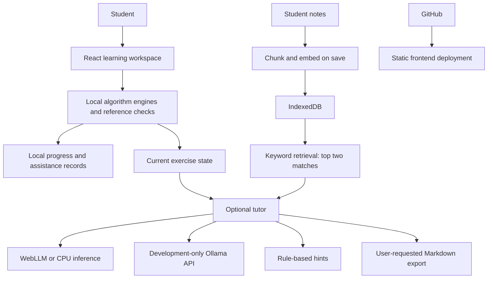

# PatternOS

A lightweight DSA learning workspace. Students predict, trace, repair and apply algorithms; optional AI helps explain their current step. Executable checks determine workshop results independently of the model.

## Journeys

Contains Duplicate; Container With Most Water; Longest Substring Without Repeating Characters; Minimum Window Substring. Changing requirements teach Sets, frequency Maps and position Maps. Fresh checks record corrections and opened help, not general mastery or coding certification.

## Run and validate

```sh
npm ci
npm run dev
npm run test:tutor
npm run build
npm run preview -- --host 127.0.0.1 --port 4180
```

Use the URL printed by Vite. Rebuild before production preview. If the server stops, a saved offline pack may reopen an older version. Refresh the saved pack after publishing updates.

## AI and retrieval

Basic Lite is rule-based, not generative AI. Browser models run through WebLLM/WebGPU or the CPU worker, with separate model downloads and hardware limits. Installed Ollama is supported through a development-only Vite proxy; it is not an inference backend hosted on Vercel. No paid cloud LLM API is configured.

Notes are chunked, embedded on save and stored in IndexedDB. Chat uses lightweight keyword-overlap retrieval of up to two chunks and injects them into AI generation context. This is a basic retrieval-augmented path, not semantic chat retrieval or a guarantee of answer faithfulness. Lite note quotations alone are not generative RAG.

Tutor shortcuts draft editable requests for one step, an analogy, a prediction check or an approach comparison. Conversation download exports Markdown without internal annotations. A transcript is not verified assessment evidence.

## Architecture



The application controls workshop tools. The LLM does not autonomously choose and call tools. There is no agent loop; do not describe this as a multi-agent system.

## Demo and capstone submission

- [Workshop guide](docs/WORKSHOP_GUIDE.md)
- [Recording script and exact prompts](docs/VIDEO_RECORDING_GUIDE.md)
- [Requirement audit](docs/CAPSTONE_AUDIT.md)

Public frontend: https://dsa-interview-coach-blue.vercel.app/. New local features appear there only after a successful push/deployment. No API key belongs in client-side variables or Git. Physical low-end hardware performance and improved learning outcomes have not been established.
